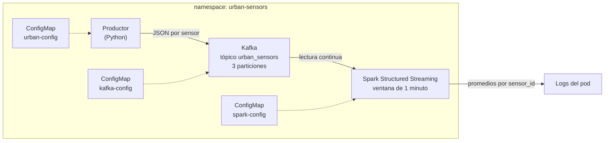

# Plataforma de muestreo urbano en tiempo real

Sensores urbanos simulados mandan mediciones a Kafka, y Spark Structured Streaming las procesa en ventanas de 1 minuto. Todo corre en Kubernetes (cluster local con `kind`).

## Arquitectura



Cada mensaje del productor tiene estos campos: `sensor_id`, `temperature`, `humidity`, `air_quality_index` y `timestamp`.

Spark agrupa por ventana de 1 minuto y por `sensor_id`, y calcula el promedio de `temperature` y de `air_quality_index`.

## Qué hay en cada pod

| Pod | Qué hace | Imagen |
|---|---|---|
| `kafka` | Un solo broker de Kafka (modo KRaft, sin Zookeeper) | `apache/kafka:3.9.0` |
| `producer` | Manda una medición por segundo al tópico `urban_sensors` | `urban-producer:1.0` (se construye en este repo) |
| `spark-streaming` | Lee del tópico, arma las ventanas y muestra los promedios | `urban-spark:1.0` (se construye en este repo) |

El conector de Kafka para Spark (`spark-sql-kafka-0-10_2.13:4.2.1`) se baja de Maven cuando arranca el pod, así que hace falta internet.

## Estructura del repositorio

```
.
├── k8s/
│   ├── 00-namespace.yaml
│   ├── 01-configmap.yaml            # urban-config: dirección de Kafka y tópico (productor)
│   ├── 02-configmap-kafka.yaml      # kafka-config: variables del broker
│   ├── 03-kafka-deployment.yaml
│   ├── 04-service-kafka.yaml
│   ├── 05-producer-deployment.yaml
│   ├── 06-configmap-spark.yaml      # spark-config: tópico, ventana, checkpoint
│   └── 07-spark-deployment.yaml
├── producer/
│   ├── producer.py
│   ├── requirements.txt
│   └── Dockerfile
├── spark/
│   ├── spark_job.py
│   └── Dockerfile
├── EVIDENCIA.md
└── README.md
```

Los archivos de `k8s/` tienen número adelante porque hay que aplicarlos en ese orden.

## Requisitos previos

- Docker
- `kubectl`
- `kind`
- Unos 7 GB de RAM libres para WSL o Docker (Kafka y Spark juntos consumen bastante)
- Conexión a internet (para bajar imágenes y el conector de Kafka)

## Cómo reproducirlo paso a paso

**1. Crear el cluster**

```bash
kind create cluster --name urban
```

**2. Crear el namespace y las configuraciones de Kafka**

```bash
kubectl apply -f k8s/00-namespace.yaml
kubectl apply -f k8s/01-configmap.yaml
kubectl apply -f k8s/02-configmap-kafka.yaml
```

**3. Levantar Kafka y su Service**

```bash
kubectl apply -f k8s/03-kafka-deployment.yaml
kubectl apply -f k8s/04-service-kafka.yaml
kubectl get pods -n urban-sensors
```

Esperar a que el pod `kafka` diga `1/1 Running`.

**4. Crear el tópico con 3 particiones**

```bash
kubectl exec -n urban-sensors deployment/kafka -- /opt/kafka/bin/kafka-topics.sh --bootstrap-server kafka:9092 --create --topic urban_sensors --partitions 3 --replication-factor 1
```

Verificar:

```bash
kubectl exec -n urban-sensors deployment/kafka -- /opt/kafka/bin/kafka-topics.sh --bootstrap-server kafka:9092 --describe --topic urban_sensors
```

**5. Construir las imágenes y cargarlas al cluster**

```bash
docker build -t urban-producer:1.0 producer/
docker build -t urban-spark:1.0 spark/
kind load docker-image urban-producer:1.0 --name urban
kind load docker-image urban-spark:1.0 --name urban
```

La imagen de Spark pesa unos 800 MB, así que puede tardar.

**6. Levantar el productor**

```bash
kubectl apply -f k8s/05-producer-deployment.yaml
```

**7. Levantar Spark**

```bash
kubectl apply -f k8s/06-configmap-spark.yaml
kubectl apply -f k8s/07-spark-deployment.yaml
```

Spark tarda uno o dos minutos en arrancar porque primero baja el conector de Kafka.

> **Importante:** el tópico tiene que existir antes de levantar Spark (paso 4). Si no, Spark se cae.

## Cómo verificar que funciona

**El productor manda mensajes:**

```bash
kubectl logs -n urban-sensors deployment/producer --tail=5
```

**Los mensajes llegan a Kafka:**

```bash
kubectl exec -n urban-sensors deployment/kafka -- /opt/kafka/bin/kafka-console-consumer.sh --bootstrap-server kafka:9092 --topic urban_sensors --from-beginning --max-messages 5
```

**Spark procesa las ventanas:**

```bash
kubectl logs -n urban-sensors deployment/spark-streaming | grep -E -A12 "Batch:"
```

## Evidencia de que Spark procesa lo que manda el productor

Salida real de Spark (ventana `09:46:00 - 09:47:00`, promedio por sensor):

```
Batch: 1
-------------------------------------------
+------------------------------------------+---------+------------------+---------------------+
|window                                    |sensor_id|avg_temperature   |avg_air_quality_index|
+------------------------------------------+---------+------------------+---------------------+
|{2026-11-02 09:46:00, 2026-11-02 09:47:00}|sensor-03|16.633333333333333|123.0                |
|{2026-11-02 09:46:00, 2026-11-02 09:47:00}|sensor-01|24.65             |235.0                |
|{2026-11-02 09:46:00, 2026-11-02 09:47:00}|sensor-04|33.0              |284.0                |
|{2026-11-02 09:46:00, 2026-11-02 09:47:00}|sensor-05|21.16             |143.8                |
|{2026-11-02 09:46:00, 2026-11-02 09:47:00}|sensor-02|28.0              |148.66666666666666   |
+------------------------------------------+---------+------------------+---------------------+

Batch: 2
-------------------------------------------
+------------------------------------------+---------+------------------+---------------------+
|window                                    |sensor_id|avg_temperature   |avg_air_quality_index|
+------------------------------------------+---------+------------------+---------------------+
|{2026-11-02 09:46:00, 2026-11-02 09:47:00}|sensor-03|19.72             |119.8                |
|{2026-11-02 09:46:00, 2026-11-02 09:47:00}|sensor-01|22.75             |198.5                |
|{2026-11-02 09:46:00, 2026-11-02 09:47:00}|sensor-04|25.55             |170.75               |
|{2026-11-02 09:46:00, 2026-11-02 09:47:00}|sensor-05|21.233333333333334|132.33333333333334   |
|{2026-11-02 09:46:00, 2026-11-02 09:47:00}|sensor-02|25.76             |151.8                |
+------------------------------------------+---------+------------------+---------------------+
```

Entre el lote 1 y el 2 los promedios de la misma ventana cambian (por ejemplo, `sensor-04` baja de 33.0 a 25.55 de temperatura), porque siguen llegando mensajes del productor. Eso confirma que Spark procesa los datos en tiempo real.

El tópico, creado con 3 particiones:

```
Topic: urban_sensors    PartitionCount: 3       ReplicationFactor: 1
        Partition: 0    Leader: 1       Replicas: 1     Isr: 1
        Partition: 1    Leader: 1       Replicas: 1     Isr: 1
        Partition: 2    Leader: 1       Replicas: 1     Isr: 1
```

Los logs del productor, el consumer de consola, el estado de los pods y el resto de los comandos están en [EVIDENCIA.md](EVIDENCIA.md).

## Configuración (ConfigMaps)

No hay valores escritos en el código ni credenciales: todo se lee de variables de entorno que vienen de ConfigMaps.

| ConfigMap | Variable | Valor | Para qué sirve |
|---|---|---|---|
| `urban-config` | `KAFKA_BOOTSTRAP_SERVERS` | `kafka:9092` | A dónde manda el productor |
| `urban-config` | `KAFKA_TOPIC` | `urban_sensors` | Tópico del productor |
| `kafka-config` | `KAFKA_NUM_PARTITIONS` | `3` | Particiones por defecto de los tópicos |
| `kafka-config` | (otras 8) | ver `k8s/02-configmap-kafka.yaml` | Configuración del broker (un solo nodo, modo KRaft) |
| `spark-config` | `KAFKA_BOOTSTRAP_SERVERS` | `kafka:9092` | A dónde se conecta Spark |
| `spark-config` | `KAFKA_TOPIC` | `urban_sensors` | Tópico que lee Spark |
| `spark-config` | `WINDOW_DURATION` | `1 minute` | Tamaño de la ventana |
| `spark-config` | `STARTING_OFFSETS` | `latest` | Lee solo los mensajes nuevos |
| `spark-config` | `CHECKPOINT_DIR` | `/tmp/checkpoint` | Dónde Spark guarda su progreso |

## Un error que tuve y cómo lo resolví

La primera vez que levanté Spark, el pod quedó en `CrashLoopBackOff` y los logs mostraban:

```
UnknownTopicOrPartitionException: This server does not host this topic-partition.
```

El tópico existía en Kafka (lo veía con `--list`), así que el problema no era Kafka. Revisé el ConfigMap con:

```bash
kubectl get configmap spark-config -n urban-sensors -o yaml | grep KAFKA_TOPIC
```

y vi que tenía `urban-sensors` (guion medio, que es el nombre del namespace) en vez de `urban_sensors` (guion bajo, el nombre del tópico). Spark buscaba un tópico que no existía. Lo corregí en `k8s/06-configmap-spark.yaml`, lo apliqué y recreé el pod, porque las variables de entorno se leen solo al arrancar:

```bash
kubectl apply -f k8s/06-configmap-spark.yaml
kubectl delete pod -n urban-sensors -l app=spark-streaming
```

## Limitaciones

- **Kafka no guarda datos en disco.** Si el pod de Kafka se reinicia (por ejemplo, al reiniciar la PC), el tópico se pierde y hay que recrearlo con el comando del paso 4. Después hay que recrear el pod de Spark.
- Corre un solo broker, sin replicación (`replication-factor 1`), porque es un entorno de desarrollo.
- Spark corre en modo local dentro de un solo pod (`local[2]`), no en un cluster de Spark.
- Los resultados se muestran en la consola (los logs del pod), no se guardan en ningún lado.

## Limpieza

```bash
kind delete cluster --name urban
```

Esto borra el cluster y todo lo que tiene adentro. Los archivos del repo no se tocan.